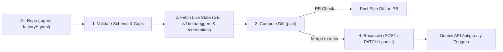

# Agent Factory — Infrastructure as Code (IaC) Architecture

This document defines the declarative, Git-backed infrastructure for managing autonomous coding agents across `@brebory`'s repositories (`ansible`, `fiber`, `home`, etc.) using **YAML files as the single source of truth**.

Instead of configuring scheduled routines manually through web UIs (which drifts from Git) or locking into a closed third-party control plane, every agent environment, schedule, credential reference, and prompt is declared in version-controlled YAML and reconciled idempotently against **Google's Gemini API Antigravity Triggers** (with room to target additional runners later).

---

## 1. Landscape & Tooling Decisions

| Tool / Platform | What it provides | Fit for this infrastructure |
| :--- | :--- | :--- |
| **Warp Factories** (`factory.yaml`, `agents/`, `automations/`, `runners/`, `scorers/`) | Closed-beta managed control plane for cloud software factories. Supports BYO-LLM and self-hosted Docker/k8s runners. | **Control plane is bound to Warp** — it cannot provision or reconcile Google's Gemini API Antigravity Triggers/Environments/Credentials. We borrow its clean directory & YAML-as-code design without adopting its lock-in. |
| **Terraform (`google` provider)** | Mature IaC for GA Google Cloud resources (Cloud Run, Secret Manager, Vertex AI). | **No native resources** for `generativelanguage.googleapis.com/v1beta/triggers`, `environments`, or `credentials` (these live on the Gemini Developer API preview surface, not GCP Resource Manager). |
| **Gemini API CLI (`gemini-api`)** | Official Google stateless binary (`google-gemini/gemini-api-cli`) with `agent`, `environments`, `credentials`, `webhooks`, `triggers`, `--schema`, and `--dry-run`. | Great imperative CLI for inspection, schema discovery, and debugging — **not** a declarative state reconciler (`plan`/`apply`/drift). |
| **`snackpackgames/agent-factory` (This Spec)** | Standalone, open-source Go CLI + reusable GitHub Action (`uses: snackpackgames/agent-factory@main`) reconciling `.agent-factory/*.yaml` against Gemini API `v1beta`. | **Implemented.** Zero lock-in, single static binary, PR-reviewed `plan` diffs, auto-`apply` on merge to `main`, stateless reconciliation (no `.tfstate`), JSON Schemas, and pluggable backends. |

---

## 2. Core Design Principles

1. **YAML in Git is the single source of truth.** Schedules, models, token caps, egress allowlists, and prompt references are never edited by hand in a dashboard.
2. **Zero secrets in Git or sandboxes.** YAML only references logical credential IDs (e.g., `github-ansible-pat`). Actual tokens are provisioned out-of-band into Gemini API's write-only **Credentials** store and injected on the wire by the sandbox egress proxy.
3. **Stateless reconciliation (no `.tfstate`).** Each live Gemini Trigger is matched deterministically by a canonical key (`<factory.name>/<automation.name>`) stored in `display_name`. `plan` diffs desired YAML against `GET /v1beta/triggers` live state; `apply` converges live state with `POST` / `PATCH` (and only deletes orphaned triggers when `--prune` is explicitly passed).
4. **Mandatory cost & safety guardrails.** Every automation must declare `model`, `max_total_tokens`, `execution_timeout_seconds`, and `max_consecutive_failures`. Validation fails closed before any API call if a cap is missing.
5. **Clean 3-repo separation.** The shareable Go reconciler + GitHub Action + JSON Schemas live in [`snackpackgames/agent-factory`](https://github.com/snackpackgames/agent-factory); studio-wide prompt templates live in `brebory/home`; individual repos only commit `.agent-factory/*.yaml` + a thin workflow.

---

## 3. Repository Directory Layout

### Reconciler Tooling (`snackpackgames/agent-factory` — Public)

```text
snackpackgames/agent-factory/
├── cmd/agent-factory/           # Go CLI (validate, plan, apply, run, status, credentials)
├── internal/                    # YAML loader, Gemini v1beta client, stateless planner/applier
├── schemas/                     # JSON Schemas (draft 2020-12) for IDE autocomplete
├── action.yml                   # Reusable composite GitHub Action
└── examples/                    # Minimal starter .agent-factory/ & GitHub workflow
```

### Per-Project Config (e.g. inside `snackpackgames/ansible`)

```text
.agent-factory/
├── factory.yaml                 # Factory metadata, defaults, template registries, required credentials
├── environments/
│   └── default.yaml             # Repo mount, git identity, egress allowlist, optional hooks
└── automations/
    ├── wayfinding.yaml          # Daily wayfinder:map frontier routine
    └── implement.yaml           # Daily ready-for-agent implementation routine
```

### Shared Studio Prompt Library (inside `brebory/home`)

```text
brebory/home/
├── docs/agents/
│   ├── agent-factory-iac.md     # This architecture & schema specification
│   └── antigravity-triggers.md  # Gemini API billing, credits, and low-level guide
└── templates/antigravity-triggers/
    ├── prompts/                 # Shared parameterized prompt templates (referenced as home://prompts/...)
    │   ├── implement-routine.template.md
    │   └── wayfinding-routine.template.md
    └── manage_triggers.py       # Lightweight zero-dep Python fallback script
```

---

## 4. Declarative YAML Schema (Draft v1)

### 4.1 `factory.yaml`

Defines factory identity, provider target, project-wide defaults, and logical credential dependencies.

```yaml
apiVersion: agent-factory/v1
kind: Factory
metadata:
  name: ansible
  repo: snackpackgames/ansible
  default_branch: main

provider:
  type: gemini-triggers               # Future: antigravity-sidecar | github-actions
  agent: antigravity-preview-09-2026

defaults:
  time_zone: America/Los_Angeles
  model: gemini-3.8-flash             # Switch to gemini-4-hydrogen on 2027-01-01
  max_total_tokens: 500000
  execution_timeout_seconds: 1800
  max_consecutive_failures: 3
  environment: default

credentials:
  - id: github-ansible-pat
    type: bearer_token
    description: Fine-grained GitHub PAT scoped to snackpackgames/ansible (Contents, Issues, PRs R/W)
```

### 4.2 `environments/default.yaml`

Defines the persistent remote Linux sandbox mounted into each trigger run.

```yaml
apiVersion: agent-factory/v1
kind: Environment
metadata:
  name: default

sandbox:
  type: remote
  sources:
    - type: repository
      source: https://github.com/snackpackgames/ansible
      target: /workspace/repo

  env:
    GIT_AUTHOR_NAME: Ansible Nightly Agent
    GIT_AUTHOR_EMAIL: ansible-agent@snackpackgames.local
    GIT_COMMITTER_NAME: Ansible Nightly Agent
    GIT_COMMITTER_EMAIL: ansible-agent@snackpackgames.local

  network:
    allowlist:
      - domain: api.github.com
        credential: github-ansible-pat
      - domain: github.com
        credential: github-ansible-pat
      - domain: "*"                   # Allow package registries without injecting GitHub auth
```

### 4.3 `automations/<name>.yaml`

Defines a single scheduled routine. Supports referencing a shared template from `brebory/home` (with `vars`) or a repo-local prompt file.

```yaml
apiVersion: agent-factory/v1
kind: Automation
metadata:
  name: wayfinding
  description: Advance one open, unblocked wayfinder ticket per night

enabled: true                         # false -> reconciles trigger status to "paused"
schedule: "0 1 * * *"                 # Standard 5-field cron (uses factory defaults.time_zone)
environment: default

runtime:
  model: gemini-3.5-flash-lite        # Override factory default for lightweight grilling/research
  max_total_tokens: 400000
  execution_timeout_seconds: 1200

prompt:
  template: home://prompts/wayfinding-routine.template.md
  vars:
    PROJECT_NAME: Ansible
    REPO: snackpackgames/ansible
    DEFAULT_BRANCH: main
    WORKSPACE_DIR: /workspace/repo
    CONTEXT_FILE: AGENTS.md
    TEST_CMD: bash scripts/test.sh
    EXTRA_RULES: |
      ## Ansible-Specific Guardrails
      - Check `CONTEXT.md` and `documentation/wayfinder/maps-index.md` for canonical terms.
      - Never create nested git worktrees inside `/workspace/repo`.
```

---

## 5. Reconciliation Lifecycle (`plan` → `apply` → `drift`)



### Operations

| Command | Behavior |
| :--- | :--- |
| `validate` | Offline schema check: verifies YAML syntax, required budget caps, template rendering (zero unresolved `{{VARS}}`), and valid cron expressions. |
| `plan` | Calls `GET /v1beta/credentials` (verifies every referenced credential ID exists) and `GET /v1beta/triggers`. Prints Terraform-style diff (`+ create`, `~ update`, `~ pause/resume`, `= unchanged`, `! orphan`). Exits non-zero on drift when `--detailed-exitcode` is set. |
| `apply` | Applies the computed plan (`POST /v1beta/triggers`, `PATCH /v1beta/triggers/{id}`). Never deletes orphaned triggers unless `--prune` is explicitly passed. |
| `run <name>` | Fires a single automation immediately (`POST /v1beta/triggers/{id}/executions`) for smoke testing. |
| `status` | Prints live trigger statuses (`active`/`paused`), `next_run_time`, `consecutive_failure_count`, and latest execution results. |

### Drift Detection & State Mapping

- Each trigger's `display_name` is formatted as `<factory.name>/<automation.name>` (e.g., `ansible/wayfinding`).
- To detect prompt or config changes cleanly without storing a state file, the reconciler compares canonicalized fields (`schedule`, `time_zone`, `status`, `max_consecutive_failures`, `execution_timeout_seconds`, `interaction.agent`, `interaction.agent_config`, `interaction.environment`, and a SHA-256 digest of the rendered prompt).
- Toggling `enabled: false` in YAML cleanly pauses the remote trigger via `PATCH {"status": "paused"}` while preserving its persistent sandbox and execution history.

---

## 6. GitOps Automation (GitHub Actions)

Once the reconciler CLI is wired up, each repo adds a single thin workflow (`.github/workflows/agent-factory.yml`):

- **On `pull_request` touching `.agent-factory/**`:**
  1. Runs `validate` (offline, works even on forks without secrets).
  2. Runs `plan` against the Gemini API (using `GEMINI_API_KEY` secret on trusted branches) and posts the diff + estimated monthly token ceiling as a PR comment.
- **On `push` to `main` touching `.agent-factory/**`:**
  1. Runs `apply` so merged YAML immediately becomes the live cloud schedule.
- **On `workflow_dispatch`:**
  - Supports manual `plan` (drift check), `apply`, or `run <automation>` directly from the GitHub Actions UI.

---

## 7. Multi-Provider Extensibility (Future)

Because the YAML models *intent* (schedule, prompt, repo mount, credential refs, budget) rather than raw HTTP payloads, the same `.agent-factory/` directory can later emit configs for multiple backends via `provider.type`:

| `provider.type` | Target Runtime | Billing / Host |
| :--- | :--- | :--- |
| `gemini-triggers` *(v1)* | Gemini API Antigravity Triggers (`v1beta`) | Gemini API credits (Google AI Pro/Ultra monthly credits) |
| `antigravity-sidecar` *(planned)* | `~/.gemini/config/sidecars/<id>/sidecar.json` | Personal Google AI subscription (local desktop) |
| `github-actions` *(planned)* | `.github/workflows/factory-<name>.yml` (`agy -p` / `gemini-api`) | GitHub Actions minutes + API key |

---

## 8. Related Docs

- [AFK Implementation Pipeline](afk-pipeline.md) — Wayfinder chart → handoff → `ready-for-agent` workflow.
- [Antigravity Triggers Quickstart & Billing](antigravity-triggers.md) — AI Studio credit activation, spend caps, and PAT setup.
- [Issue Tracker Conventions](issue-tracker.md) — GitHub REST API conventions for native sub-issues and `blocked_by` edges.
